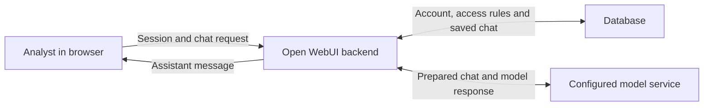

# P-006 / 6.1.1 — Identity, asset, and permission inventory

**Lab alias** · `P006-CASEB-LAB-01`

**Source** · Open WebUI tag `v0.13.4` at commit `0666e59d26a4d056e0bacee41742486badd71cf8`. The upstream tag and the fetched commit agreed on 2026-11-22. The package manifest declares source version `0.13.4`. Observed runtime version, deployment configuration, and runtime authorization are **pending**. [Engagement scope](engagement-scope.md) · [Pinned source tree][source] · [Package manifest][version]

This inventory follows the proposed workflow in which a service-desk analyst drafts an employee-facing notice using ordinary chat and synthetic notes. Sharing, tool and connector use, and automated execution are outside the exercise. The cited code paths are `SOURCE_CONFIRMED` at the pinned revision. The proposed roles, asset labels, and notice rules are `AS_DESIGNED`. Effective identities, grants, and settings in a deployment are `UNKNOWN`. B-04 and B-05 remain `NOT_TESTED`. [Project index](../../../strategy/116-projects.md) · [Work-package checklist](README.md#first-deliverables-not-completed) · [Engagement scope](engagement-scope.md)

To verify the source pin independently, run the read-only command below and compare the full SHA. Then follow the linked functions and check their callers before applying any rule to a deployment.

```sh
git ls-remote https://github.com/open-webui/open-webui.git refs/tags/v0.13.4
```

## Human identities

An identity answers **who is making the request**. The authenticated account, its application role, and the audience of the eventual notice are separate facts. Verify the role of each real lab account from an approved account record when one exists.

| Identity | What it means and why it matters | Where and how to verify in source |
| --- | --- | --- |
| Standard account (`user`) | The proposed analyst uses this role. The server loads the account ID and role from the user record. The `user` role passes the basic role gate on chat routes. Each action can still have additional checks. | Find `User.id` and `User.role`, follow `get_current_user` to `Users.get_user_by_id`, then check `VERIFIED_USER_ROLES` and `get_verified_user`. [`User`][user] · [Authentication][current-user] · [Verified-user gate][verified] |
| Administrator (`admin`) | This role passes both the verified-user gate and the administrator gate. It can change the default user permissions, so the identity used for administrative work matters when interpreting a standard user's access. | Read `get_admin_user` and check the dependency and configuration write in `update_default_user_permissions`. [Administrator gate][admin] · [Permission settings][permission-update] |
| Pending account (`pending`) | This account role fails the verified-user and administrator gates. The source uses `pending` as the fallback default role. In `signup_handler`, the account created when the user count is one is promoted to `admin`. A lab account's actual role must be reviewed after setup. | Compare `DEFAULT_USER_ROLE` and its `ui.default_user_role` mapping with the configured role read and the promotion branch in `signup_handler`, then check the two role gates. [Role default][default-role] · [Config mapping][role-map] · [Signup][signup] · [Verified-user gate][verified] · [Administrator gate][admin] |
| Caller without credentials | The authentication dependency rejects a request with no accepted credential. This matters for ordinary protected chat and administration routes. The separate shared-chat path has its own access rules. | Read the credential lookup and missing-token branch in `get_current_user`. Check its use in `get_verified_user`. [Authentication][current-user] · [Verified-user gate][verified] |
| Intended employee reader and lab owner | These are proposed roles in the exercise. The notice policy permits different fields for different audiences. The lab owner decides who may inspect or run the lab. Their application accounts and roles are `UNKNOWN`. | Compare the audience rule with the proposed workflow, and obtain the lab owner's scope approval before any runtime review. [Engagement scope](engagement-scope.md#proposed-workflow-and-risk-status) |

## Workload identities

A workload is software making a request or operating on data. Its credentials determine what the receiving service sees. Record the identity and allowed scope of each workload before a live assessment, using credential references and redacting values.

| Workload or credential holder | What it does and why it matters | Where and how to verify in source |
| --- | --- | --- |
| Open WebUI backend process | The application signs and verifies session tokens (JWTs) with `SESSION_SECRET`, which is set from `WEBUI_SECRET_KEY`. The process checks the incoming credential and resolves the corresponding user. Its deployed OS account or workload principal is `UNKNOWN`. | Follow `SESSION_SECRET` into `create_token` and `decode_token`. Read `get_current_user` where it loads the account after validation. Check the eventual service definition for the process identity. [Signing configuration][session-secret] · [JWT functions][jwt] · [Authentication][current-user] |
| Backend database connection | The backend opens sessions on its configured database engine. The source falls back to a local SQLite file. A configured PostgreSQL connection can use an AWS RDS IAM token when enabled. The effective database, login, and grants are `UNKNOWN`. | Trace `DATABASE_URL`, `AsyncSessionLocal`, and the conditional `RDSIAMTokenAuth` hook. Review the lab's database type, mounted data path or database principal, and grants when available. [Database configuration][db-url] · [Engine][db-engine] · [Session factory][db-session] · [Optional IAM connection auth][db-iam] |
| Backend model-provider connection | The server can send the prepared chat payload to a configured OpenAI-compatible or Ollama service. In the standard OpenAI-compatible bearer branch, the connection key becomes the outbound bearer credential when present. Other configured modes change which credential is sent. The selected provider, destination, and credential identity are `UNKNOWN`. | Trace `utils.chat.generate_chat_completion` to the provider handler, the connection lookup, and `get_headers_and_cookies`. Verify the chosen URL and authentication mode from a sanitized deployment record. [Dispatcher][dispatch] · [OpenAI connection][provider-config] · [OpenAI request][openai-post] · [Ollama request][ollama-post] · [Header builder][provider-headers] |
| Client using an Open WebUI API key | A matching key resolves to its associated Open WebUI account. API-key access has a global enable check, a non-admin feature permission, and a path check when endpoint restrictions are enabled. This route is adjacent to the browser workflow. Effective key use is `UNKNOWN`. | Follow the join in `get_user_by_api_key`, then the checks in `get_current_user_by_api_key`. Review approved API-key settings before assessing any scripted client. [Key lookup][api-account] · [API-key enforcement][api-check] |
| Scheduled automation or subagent | The source can issue owner-bound tokens of type `automation` or `subagent`. Both token builders check the owner credential's active flag. These are delegated workloads outside this exercise. Their configuration and use are `UNKNOWN`. | Read `execute_automation` and the subagent `_build_request`. Compare the owner ID and token type in both. [Automation][automation] · [Subagent][subagent] |

## Asset classification

These are proposed lab classifications. **Internal** means for lab use. **Confidential** means restrict to the intended readers. **Restricted** means protect credentials and high-impact control data. The ticket reference is fictional. Its confidential label represents the rule the exercise proposes for a real internal reference. If a record includes more sensitive content, apply the higher classification.

| Asset | Proposed class and why it matters | Where it can appear and how to verify |
| --- | --- | --- |
| Pasted notes, ticket reference, and assistant draft | **Confidential.** The source notes can include material the employee-facing draft should omit. The draft remains lab material while it is reviewed. | For saved chat, `Chat` has an owner ID and JSON data, and `ChatMessage` stores message content and output. `insert_new_chat` writes the chat and attempts to write initial messages to the message table. The non-streaming handler saves assistant output when `save_to_chat` is true. Review those fields, then verify any actual retention and backup policy separately. [Chat schema][chat] · [Message schema][chat-message] · [Chat writes][create-storage] · [Response write][assistant-output] |
| Account and access policy records | **Confidential.** Account records contain identity and role information. Group memberships, permissions, and resource grants affect who can act, so changes need authorized control. | Check `User`, `Group`, `GroupMember`, and `AccessGrant` for the stored fields. An access grant links a resource, a recipient such as a user or group, and a permission such as read or write. Verify actual memberships and grants with the approved account inventory. [Account][user] · [Groups and membership][groups] · [Resource grants][grant] |
| Authentication material | **Restricted.** Password hashes, MFA data, session tokens, API keys, and the signing secret protect access or support its verification. | Check `Auth.password`, `Auth.mfa`, the `ApiKey` schema, and `create_session_response`. Confirm which credential sources the lab enables from approved configuration summaries. [Credential record][auth-record] · [API-key record][api-record] · [Session issuance][session-issue] · [Signing configuration][session-secret] |
| Model configuration and provider or database credentials | **Internal** for model IDs and routing metadata, **restricted** for credential material. Model parameters and upstream routes affect what processes the request. | Check `Model.user_id`, `base_model_id`, and `params`, the provider connection settings read by `get_openai_runtime_config`, and `DATABASE_URL`. Review the chosen model, connection, and credential references. [Model record][model] · [Provider settings][provider-settings] · [Database configuration][db-url] |
| Share record, if sharing is enabled | **Confidential.** The share can carry a copy of the saved transcript. The share recipient can be different from the notice's intended employee audience. | `SharedChatsTable.create` copies chat JSON into `SharedChat`. `get_shared_chat_by_id` has distinct access and continued-chat branches. Review the configured share policy during runtime scoping. [Share record][share-record] · [Share lookup][share-read] |
| Events and audit data, if collected | **Confidential**, or higher when payloads contain more sensitive material. Even a message preview can include internal details. | In the new saved-chat path, `chat_completion` can put the first 300 characters of the user message in a `MESSAGE_CREATED` event. `publish_event` dispatches through configured sink behavior, and audit middleware registration is conditional on audit level. Effective recipients, log contents, and retention are `UNKNOWN`. Verify configuration and approved evidence storage before a live exercise. [Event payload][preview] · [Event dispatch][events] · [Audit registration][audit] |

## How authorization works

1. **Authenticate the caller.** `get_current_user` accepts a bearer or cookie credential and also checks a credential set by middleware. For signed sessions it decodes the token, calls `is_valid_token`, and uses the resulting user ID to load the account. Role checks use that account. Review the validation branch and the role gate of the exact handler being assessed. For sign-in, the local password branch and the OAuth callback can both call `create_signin_response`, which can require MFA (a second authentication factor). Verify the lab's actual login and MFA settings separately. [Authentication][current-user] · [Session validation][session-check] · [Verified-user gate][verified] · [Password sign-in][password-signin] · [OAuth sign-in][oauth-signin] · [MFA decision][signin-policy]
2. **Check whether the account may use the feature.** `has_permission` checks inherited group memberships for a grant of the feature, then falls back to the configured defaults with missing settings filled. `get_permissions` combines group settings with the defaults, favoring permission when either side grants it. Review the specific permission key at the caller. [Feature permission functions][feature-permissions] · [Default permission definitions][default-permissions]
3. **Check whether the account may act on this resource.** The database-backed `AccessGrants.has_access` checks a permission for a particular resource against a matching user, group, or wildcard user grant. Callers such as `has_chat_access` and the model predicate also apply ownership rules. Review the check for the exact resource and action, since a chat read and a model call have different rules. [Grant lookup][grant-lookup] · [Grant expression][grant-expression] · [Chat access predicate][chat-access] · [Model access predicate][model-access]

## Initial role-and-permission matrix

These are source conditions for the named operations. A verified caller must still reach the corresponding branch with the right resource and settings. `pending` and unauthenticated callers are blocked on the protected handlers in this table. For a live review, compare the documented conditions with the account role, resource ownership, group grants, and effective configuration. [Verified-user gate][verified] · [Administrator gate][admin]

| Operation | Standard user (`user`) | Administrator (`admin`) | Where and how to verify |
| --- | --- | --- | --- |
| List own saved chats | The session list filters on the caller's ID. | The same session list filters on the caller's ID. A separate operator route lists another user's chat summaries only when `ENABLE_ADMIN_CHAT_ACCESS` is enabled. | Compare `get_session_user_chat_list`, its database query, and the administrator dependency and flag check in `get_user_chat_list_by_user_id`. [Session list][chat-list] · [Owner-filtered query][chat-list-query] · [Administrator list][admin-chat-list] |
| Create a saved chat | Creates for the caller. A selected folder requires write access. The saved-chat creation guard denies a non-admin when temporary chat is enabled and enforced. | Creates for the caller. The selected-folder check still runs on this handler. The saved-chat creation guard returns early for an admin. | Follow `create_new_chat` into `insert_new_chat` and `require_chat_creation_permission`. [Create handler][chat-create] · [Saved-chat guard][create-guard] |
| Read a saved chat by ID | Owner or qualifying shared-chat or folder access. | Same routes for a qualifying grant, plus the administrator read branch for `ENABLE_ADMIN_CHAT_ACCESS` or internal chat metadata. The source fallback for the flag is `True`. | Trace `get_chat_by_id` through `get_accessible_chat_by_id` into `has_chat_access`. Compare the read rule with the flag definition. [Read handler][chat-read] · [Chat access predicate][chat-access] · [Flag fallback][admin-chat-flag] |
| Submit a new turn in an existing saved chat | Requires the named chat's write-access check on the ordinary saved-chat branch. | Same check. The admin-specific read branch in `has_chat_access` is limited to reads. | Find `permission='write'` in `main.chat_completion` and the branches of `has_chat_access`. [Saved-chat turn][write-turn] · [Chat access predicate][chat-access] |
| Delete a saved chat by ID | Requires `chat.delete` and ownership. | Can delete an owned chat. Deleting someone else's chat through this handler requires `ENABLE_ADMIN_CHAT_ACCESS`. | Read `delete_chat_by_id` up to the first side effect and the owner-filtered lookup it uses. [Delete handler][chat-delete] · [Owner lookup][chat-owner] |
| Generate with an ordinary registered server-managed model | When model checks apply, requires ownership or a matching read grant, with checks on chained base models. Model availability also matters. | The entry handler applies the model check when neither the global flag nor the admin model bypass flag permits skipping it. | Read the condition in `main.chat_completion`, follow the `utils.models.check_model_access` predicate, and inspect the configuration definitions. This row covers the normal managed-model path. [Entry handler][model-entry] · [Model access predicate][model-access] · [Global flag][model-flag] · [Admin flag][admin-model-flag] |
| Change default user permissions, a group, or OpenAI-compatible provider settings | Blocked by the admin dependency on these routes. | Allowed by the role gate. The handlers update the relevant policy or provider record. | Inspect `update_default_user_permissions`, `update_group_by_id`, and the OpenAI router's `update_config`. [Permission settings][permission-update] · [Group update][group-update] · [Provider settings update][provider-update] |
| Create or refresh a chat share (outside this exercise) | Requires ownership and the `chat.share` feature permission. | Requires ownership. This handler skips the feature permission check for admins. | Compare the role check, owner lookup, and snapshot code in `share_chat_by_id`. Reader access is checked separately. [Share handler][chat-share] · [Share lookup][share-read] |

## Trust boundaries

A trust boundary is where data or authority moves between components. The diagram shows the logical path for the proposed ordinary chat workflow. Its deployed hosts, accounts, and settings are `UNKNOWN`.



| Boundary | What crosses and why it matters | Where and how to verify |
| --- | --- | --- |
| Browser → backend | The browser sends chat data and a user credential. The backend decides who the caller is and whether the requested chat or model is allowed. A user ID or audience stated in chat text provides no evidence of permission. | Trace `generateOpenAIChatCompletion` to `main.chat_completion`, then read the authentication and model/chat guards. Correlate effective account and resource permissions only in a future authorized deployment. [Browser request][browser-request] · [Chat entry][chat-entry] · [Authentication][current-user] · [Saved-chat turn][write-turn] |
| Identity provider → backend (optional) | With OAuth enabled, the callback exchanges the sign-in response for a token and looks up a local account by provider and subject ID. The external identity must be linked to the intended local account. | Follow `OAuthManager.handle_callback` to `authorize_access_token`, `get_user_by_oauth_sub`, and `create_signin_response`. Confirm the configured provider and account mapping if the lab uses OAuth. [OAuth token exchange][oauth-exchange] · [Account mapping][oauth-account] · [OAuth sign-in][oauth-signin] |
| Backend ↔ database | Account records, grants, and saved messages are persisted and read under the application's database connection. Application handlers decide which records the caller can access. Database access and backups need their own control review. | Follow the session factory to the chat and grant queries. Review the database principal or file access, backup policy, and storage permissions in the actual lab. [Session factory][db-session] · [Owner lookup][chat-owner] · [Grant lookup][grant-expression] |
| Backend ↔ model provider | Prepared chat content crosses to the selected provider. A configured credential can cross with it. The header builder can forward user information and the chat ID when `ENABLE_FORWARD_USER_INFO_HEADERS` applies. This matters for who can receive the input and what they can retain. | Follow the HTTP request from `generate_chat_completion` and check `get_headers_and_cookies`. Verify the exact destination, auth mode, enabled metadata forwarding, and provider data policy before any live run. [OpenAI request][openai-post] · [Ollama request][ollama-post] · [Header builder][provider-headers] |
| Model response → analyst | The response becomes assistant output in the chat and can be saved. The proposed notice needs an audience and field check before the analyst relies on it. | Check `non_streaming_chat_response_handler` where it emits and conditionally saves assistant output, and `chatCompletionEventHandler` in the UI. Use the written notice rules for any later evaluation. [Response handling][assistant-output] · [UI handling][browser-output] |
| Chat or events → additional readers (adjacent) | A share creates another copy of chat data. An event can carry a preview to a delivery mechanism. These paths can expand the audience beyond the analyst and model backend. | Compare `SharedChatsTable.create`, `get_shared_chat_by_id`, and `publish_event`. Record effective share permissions and event destinations from approved configuration. [Share record][share-record] · [Share lookup][share-read] · [Event dispatch][events] |

## Case B implications

The code above gives review points for identity, storage, and permissions. The two proposed behavior requirements come from the legitimate-use scenario. Keep the result for each risk tied to evidence collected in a later authorized assessment. [B-05 and B-04 in the risk inventory](../../../strategy/110-risks.md#phase-1--ai-reliability-truth--independent-verification) · [Proposed sublayer mappings](../../../strategy/334-subsublayers.md#case-b-risk-names-and-proposed-corrected-sublayer-links) · [Working principles](../../../AGENTS.md#working-principles)

| Risk | Implication for the synthetic notice | Independent verification to plan | Status |
| --- | --- | --- | --- |
| **B-04 — User-Intent Misunderstanding** | The authenticated analyst can be permitted to chat while the intended audience of the notice is still unclear. The proposed requirement is to ask which audience to use before drafting when that answer changes what can be included. | Agree on the audience rule with the reviewer. If a later run is authorized, compare the first response against that rule. Verify the account and any resulting effects through approved configuration or records. | `NOT_TESTED` |
| **B-05 — Security Constraint Omission** | The proposed draft keeps approved service details and omits the synthetic internal ticket reference when the employee audience is explicit. This is a rule for the draft. Pasted notes still enter the chat and provider path described above. | Define the allowed fields and the synthetic reference up front. In an authorized run, compare the actual draft against that list. Any claim about storage, sharing, or egress needs its own backend evidence. | `NOT_TESTED` |

## Runtime details pending

On an authorized isolated instance, verify the displayed build against the deployed image or source commit. Use approved records to confirm the test account and role, group membership, model grants and route, credential identities, database configuration, chat retention, and which sharing, connector, or event settings apply. Record sanitized references to those records and to the owner's approval. Runtime observations, test executions, and vulnerability findings are absent from this source review. [Scope handoff](engagement-scope.md#runtime-details-to-verify-later)

[source]: https://github.com/open-webui/open-webui/tree/0666e59d26a4d056e0bacee41742486badd71cf8
[version]: https://github.com/open-webui/open-webui/blob/0666e59d26a4d056e0bacee41742486badd71cf8/package.json#L1-L5
[user]: https://github.com/open-webui/open-webui/blob/0666e59d26a4d056e0bacee41742486badd71cf8/backend/open_webui/models/users.py#L140-L148
[current-user]: https://github.com/open-webui/open-webui/blob/0666e59d26a4d056e0bacee41742486badd71cf8/backend/open_webui/utils/auth.py#L398-L491
[verified]: https://github.com/open-webui/open-webui/blob/0666e59d26a4d056e0bacee41742486badd71cf8/backend/open_webui/utils/auth.py#L570-L579
[admin]: https://github.com/open-webui/open-webui/blob/0666e59d26a4d056e0bacee41742486badd71cf8/backend/open_webui/utils/auth.py#L628-L634
[permission-update]: https://github.com/open-webui/open-webui/blob/0666e59d26a4d056e0bacee41742486badd71cf8/backend/open_webui/routers/users.py#L442-L459
[default-role]: https://github.com/open-webui/open-webui/blob/0666e59d26a4d056e0bacee41742486badd71cf8/backend/open_webui/config.py#L1752-L1754
[role-map]: https://github.com/open-webui/open-webui/blob/0666e59d26a4d056e0bacee41742486badd71cf8/backend/open_webui/config.py#L3270-L3271
[signup]: https://github.com/open-webui/open-webui/blob/0666e59d26a4d056e0bacee41742486badd71cf8/backend/open_webui/routers/auths.py#L791-L834
[session-secret]: https://github.com/open-webui/open-webui/blob/0666e59d26a4d056e0bacee41742486badd71cf8/backend/open_webui/utils/auth.py#L45-L48
[jwt]: https://github.com/open-webui/open-webui/blob/0666e59d26a4d056e0bacee41742486badd71cf8/backend/open_webui/utils/auth.py#L225-L244
[db-url]: https://github.com/open-webui/open-webui/blob/0666e59d26a4d056e0bacee41742486badd71cf8/backend/open_webui/env.py#L261-L287
[db-engine]: https://github.com/open-webui/open-webui/blob/0666e59d26a4d056e0bacee41742486badd71cf8/backend/open_webui/internal/db.py#L495-L519
[db-session]: https://github.com/open-webui/open-webui/blob/0666e59d26a4d056e0bacee41742486badd71cf8/backend/open_webui/internal/db.py#L554-L583
[db-iam]: https://github.com/open-webui/open-webui/blob/0666e59d26a4d056e0bacee41742486badd71cf8/backend/open_webui/internal/db.py#L212-L280
[dispatch]: https://github.com/open-webui/open-webui/blob/0666e59d26a4d056e0bacee41742486badd71cf8/backend/open_webui/utils/chat.py#L222-L255
[provider-config]: https://github.com/open-webui/open-webui/blob/0666e59d26a4d056e0bacee41742486badd71cf8/backend/open_webui/routers/openai.py#L250-L255
[openai-post]: https://github.com/open-webui/open-webui/blob/0666e59d26a4d056e0bacee41742486badd71cf8/backend/open_webui/routers/openai.py#L1563-L1650
[ollama-post]: https://github.com/open-webui/open-webui/blob/0666e59d26a4d056e0bacee41742486badd71cf8/backend/open_webui/routers/ollama.py#L1181-L1198
[provider-headers]: https://github.com/open-webui/open-webui/blob/0666e59d26a4d056e0bacee41742486badd71cf8/backend/open_webui/utils/headers.py#L175-L230
[api-account]: https://github.com/open-webui/open-webui/blob/0666e59d26a4d056e0bacee41742486badd71cf8/backend/open_webui/models/users.py#L421-L432
[api-check]: https://github.com/open-webui/open-webui/blob/0666e59d26a4d056e0bacee41742486badd71cf8/backend/open_webui/utils/auth.py#L512-L553
[automation]: https://github.com/open-webui/open-webui/blob/0666e59d26a4d056e0bacee41742486badd71cf8/backend/open_webui/utils/automations.py#L345-L385
[subagent]: https://github.com/open-webui/open-webui/blob/0666e59d26a4d056e0bacee41742486badd71cf8/backend/open_webui/utils/subagents.py#L66-L88
[chat]: https://github.com/open-webui/open-webui/blob/0666e59d26a4d056e0bacee41742486badd71cf8/backend/open_webui/models/chats.py#L209-L230
[chat-message]: https://github.com/open-webui/open-webui/blob/0666e59d26a4d056e0bacee41742486badd71cf8/backend/open_webui/models/chat_messages.py#L161-L179
[create-storage]: https://github.com/open-webui/open-webui/blob/0666e59d26a4d056e0bacee41742486badd71cf8/backend/open_webui/models/chats.py#L694-L750
[assistant-output]: https://github.com/open-webui/open-webui/blob/0666e59d26a4d056e0bacee41742486badd71cf8/backend/open_webui/utils/middleware.py#L4184-L4216
[groups]: https://github.com/open-webui/open-webui/blob/0666e59d26a4d056e0bacee41742486badd71cf8/backend/open_webui/models/groups.py#L36-L90
[grant]: https://github.com/open-webui/open-webui/blob/0666e59d26a4d056e0bacee41742486badd71cf8/backend/open_webui/models/access_grants.py#L23-L32
[auth-record]: https://github.com/open-webui/open-webui/blob/0666e59d26a4d056e0bacee41742486badd71cf8/backend/open_webui/models/auths.py#L27-L37
[api-record]: https://github.com/open-webui/open-webui/blob/0666e59d26a4d056e0bacee41742486badd71cf8/backend/open_webui/models/users.py#L237-L247
[session-issue]: https://github.com/open-webui/open-webui/blob/0666e59d26a4d056e0bacee41742486badd71cf8/backend/open_webui/utils/auth.py#L700-L746
[model]: https://github.com/open-webui/open-webui/blob/0666e59d26a4d056e0bacee41742486badd71cf8/backend/open_webui/models/models.py#L190-L204
[provider-settings]: https://github.com/open-webui/open-webui/blob/0666e59d26a4d056e0bacee41742486badd71cf8/backend/open_webui/routers/openai.py#L230-L237
[share-record]: https://github.com/open-webui/open-webui/blob/0666e59d26a4d056e0bacee41742486badd71cf8/backend/open_webui/models/shared_chats.py#L63-L94
[share-read]: https://github.com/open-webui/open-webui/blob/0666e59d26a4d056e0bacee41742486badd71cf8/backend/open_webui/routers/chats.py#L1299-L1327
[preview]: https://github.com/open-webui/open-webui/blob/0666e59d26a4d056e0bacee41742486badd71cf8/backend/open_webui/main.py#L1479-L1490
[events]: https://github.com/open-webui/open-webui/blob/0666e59d26a4d056e0bacee41742486badd71cf8/backend/open_webui/events.py#L1249-L1286
[audit]: https://github.com/open-webui/open-webui/blob/0666e59d26a4d056e0bacee41742486badd71cf8/backend/open_webui/main.py#L774-L792
[session-check]: https://github.com/open-webui/open-webui/blob/0666e59d26a4d056e0bacee41742486badd71cf8/backend/open_webui/utils/auth.py#L269-L305
[password-signin]: https://github.com/open-webui/open-webui/blob/0666e59d26a4d056e0bacee41742486badd71cf8/backend/open_webui/routers/auths.py#L763-L785
[oauth-signin]: https://github.com/open-webui/open-webui/blob/0666e59d26a4d056e0bacee41742486badd71cf8/backend/open_webui/utils/oauth.py#L2304-L2309
[oauth-exchange]: https://github.com/open-webui/open-webui/blob/0666e59d26a4d056e0bacee41742486badd71cf8/backend/open_webui/utils/oauth.py#L1957-L1975
[oauth-account]: https://github.com/open-webui/open-webui/blob/0666e59d26a4d056e0bacee41742486badd71cf8/backend/open_webui/utils/oauth.py#L2095-L2104
[signin-policy]: https://github.com/open-webui/open-webui/blob/0666e59d26a4d056e0bacee41742486badd71cf8/backend/open_webui/utils/auth.py#L671-L697
[feature-permissions]: https://github.com/open-webui/open-webui/blob/0666e59d26a4d056e0bacee41742486badd71cf8/backend/open_webui/utils/access_control/__init__.py#L32-L103
[default-permissions]: https://github.com/open-webui/open-webui/blob/0666e59d26a4d056e0bacee41742486badd71cf8/backend/open_webui/config.py#L1985-L2047
[grant-lookup]: https://github.com/open-webui/open-webui/blob/0666e59d26a4d056e0bacee41742486badd71cf8/backend/open_webui/models/access_grants.py#L561-L596
[grant-expression]: https://github.com/open-webui/open-webui/blob/0666e59d26a4d056e0bacee41742486badd71cf8/backend/open_webui/models/access_grants.py#L740-L758
[chat-access]: https://github.com/open-webui/open-webui/blob/0666e59d26a4d056e0bacee41742486badd71cf8/backend/open_webui/models/chats.py#L2033-L2094
[model-access]: https://github.com/open-webui/open-webui/blob/0666e59d26a4d056e0bacee41742486badd71cf8/backend/open_webui/utils/models.py#L535-L599
[chat-list]: https://github.com/open-webui/open-webui/blob/0666e59d26a4d056e0bacee41742486badd71cf8/backend/open_webui/routers/chats.py#L335-L366
[chat-list-query]: https://github.com/open-webui/open-webui/blob/0666e59d26a4d056e0bacee41742486badd71cf8/backend/open_webui/models/chats.py#L1817-L1842
[admin-chat-list]: https://github.com/open-webui/open-webui/blob/0666e59d26a4d056e0bacee41742486badd71cf8/backend/open_webui/routers/chats.py#L817-L830
[chat-create]: https://github.com/open-webui/open-webui/blob/0666e59d26a4d056e0bacee41742486badd71cf8/backend/open_webui/routers/chats.py#L853-L876
[create-guard]: https://github.com/open-webui/open-webui/blob/0666e59d26a4d056e0bacee41742486badd71cf8/backend/open_webui/models/chats.py#L676-L704
[chat-read]: https://github.com/open-webui/open-webui/blob/0666e59d26a4d056e0bacee41742486badd71cf8/backend/open_webui/routers/chats.py#L1464-L1490
[admin-chat-flag]: https://github.com/open-webui/open-webui/blob/0666e59d26a4d056e0bacee41742486badd71cf8/backend/open_webui/env.py#L361
[write-turn]: https://github.com/open-webui/open-webui/blob/0666e59d26a4d056e0bacee41742486badd71cf8/backend/open_webui/main.py#L1547-L1572
[chat-delete]: https://github.com/open-webui/open-webui/blob/0666e59d26a4d056e0bacee41742486badd71cf8/backend/open_webui/routers/chats.py#L1756-L1796
[chat-owner]: https://github.com/open-webui/open-webui/blob/0666e59d26a4d056e0bacee41742486badd71cf8/backend/open_webui/models/chats.py#L2015-L2028
[model-entry]: https://github.com/open-webui/open-webui/blob/0666e59d26a4d056e0bacee41742486badd71cf8/backend/open_webui/main.py#L1141-L1188
[model-flag]: https://github.com/open-webui/open-webui/blob/0666e59d26a4d056e0bacee41742486badd71cf8/backend/open_webui/env.py#L842
[admin-model-flag]: https://github.com/open-webui/open-webui/blob/0666e59d26a4d056e0bacee41742486badd71cf8/backend/open_webui/config.py#L2159-L2167
[provider-update]: https://github.com/open-webui/open-webui/blob/0666e59d26a4d056e0bacee41742486badd71cf8/backend/open_webui/routers/openai.py#L515-L534
[group-update]: https://github.com/open-webui/open-webui/blob/0666e59d26a4d056e0bacee41742486badd71cf8/backend/open_webui/routers/groups.py#L182-L200
[chat-share]: https://github.com/open-webui/open-webui/blob/0666e59d26a4d056e0bacee41742486badd71cf8/backend/open_webui/routers/chats.py#L2151-L2185
[browser-request]: https://github.com/open-webui/open-webui/blob/0666e59d26a4d056e0bacee41742486badd71cf8/src/lib/apis/openai/index.ts#L376-L391
[chat-entry]: https://github.com/open-webui/open-webui/blob/0666e59d26a4d056e0bacee41742486badd71cf8/backend/open_webui/main.py#L1096-L1108
[browser-output]: https://github.com/open-webui/open-webui/blob/0666e59d26a4d056e0bacee41742486badd71cf8/src/lib/components/chat/Chat.svelte#L3995-L4025
