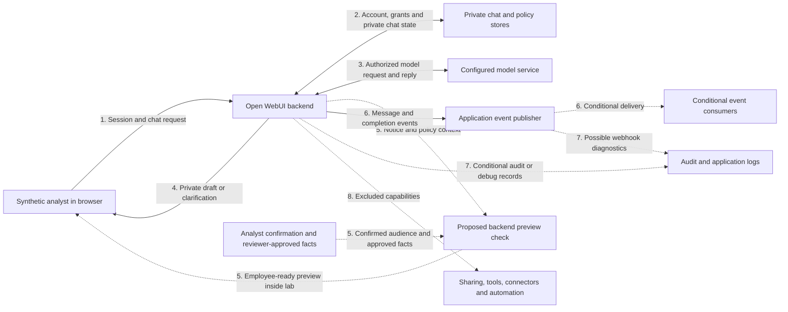

# P-006 / 6.1.1 — Trust boundaries and data flow

**Lab** · `P006-CASEB-LAB-01`

**Source** · Open WebUI `v0.13.4` at `0666e59d26a4d056e0bacee41742486badd71cf8`. The upstream tag and fetched commit agreed. The lab documents were read from `main` at `12fe1789bb106e4a36d1bb91814b209e6d2fa52e`. [Pinned source][upstream] · [Engagement scope](engagement-scope.md) · [Identity and asset inventory](identities-and-assets.md) · [Requirements and invariants](security-requirements.md)

This is a source-only review of ordinary saved chat for a synthetic service notice. **`SOURCE_CONFIRMED`** describes a path visible in code. **`AS_DESIGNED`** describes a proposed lab control. The deployed build, settings, identities, and actual destinations are **`UNKNOWN`**. Runtime authorization is pending and both Case B risks remain **`NOT_TESTED`**. [Work-package checklist](README.md#first-deliverables-not-completed) · [Agent instructions](../../../AGENTS.md#working-principles) · [Curriculum](../../../strategy/334-subsublayers.md#61--ai-application-foundations) · [Project index](../../../strategy/116-projects.md)

## Architecture

The analyst signs in, enters synthetic notes, and receives either a clarification question or a private draft. The application checks the user and the resources, records the allowed chat state, and can send prepared messages to a model service. Events and logs have their own paths and readers. The proposed preview check would use the analyst's confirmed audience and the reviewer's approved facts to build an employee-ready preview for use **inside the lab**.

Solid arrows identify ordinary source paths under the applicable handler conditions. Dotted arrows identify conditional paths, the proposed preview check, or capabilities excluded from this exercise. Boundary numbers match the register below.

| Actor or workload | Authority and assets |
| --- | --- |
| Synthetic service-desk analyst | A proposed standard `user` runs the private chat. The application verifies the account and relevant chat or model access. The analyst owns the synthetic notes and confirms the notice audience. |
| Lab owner, administrator, and reviewer | The lab owner approves runtime scope. A separately authorized administrator manages settings. The proposed reviewer approves the service facts and their version. These responsibilities may belong to different people. |
| Intended employee reader | This is an audience in the notice policy. The workflow ends at lab review of the preview. |
| Open WebUI backend and database connection | The backend resolves the user and uses its configured database connection to read policy and write saved chat. Account and grant records and the transcript are confidential. Session and connection credentials are restricted. |
| Model service | The selected provider can receive the approved synthetic input and the configured provider credential. Its reply is content for the private draft. The service identity, destination, and data-handling policy need runtime confirmation. |
| Event consumers and log readers | A webhook, function, notification recipient, or log collector can have a different audience from the chat owner. Inspect each enabled reader, destination, and retained copy. |

The actor and data classes follow the inventory. The numbered paths below link to the actual entry points and source checks. [Human identities](identities-and-assets.md#human-identities) · [Workloads](identities-and-assets.md#workload-identities) · [Asset classification](identities-and-assets.md#asset-classification)

### 1 — Browser to application over HTTP

- **What crosses and what can change.** The password sign-in path `POST /api/v1/auths/signin` can issue a signed session token. The browser's chat helper sends a bearer credential and JSON to `POST /api/chat/completions`. The request can include the selected model, the user message, and an existing chat ID. The server's `get_current_user` reads the credential, checks a signed session, and loads the account. The completion handler requires `get_verified_user`. Privileged settings such as default permissions use `get_admin_user`. [Router mounts][mounts] · [Sign-in entry][signin-route] · [Password sign-in][signin] · [Session issuance][issue-session] · [Browser chat request][browser-request] · [Browser payload][browser-chat] · [Identity lookup][http-auth] · [Verified-user check][roles] · [Chat entry][chat-entry] · [Admin check][admin-role] · [Permission settings][permissions-update]
- **Benign failure and control.** An old open tab may submit a draft after the session expires, or the analyst may mention an administrator in the text. The server must resolve the current account and role from verified credentials and policy before any protected effect. Use a standard analyst for the workflow and a separately authorized admin for settings.
- **Independent check and evidence.** Follow the authentication dependency into the loaded account and handler role check. In a future authorized lab, reconcile the effective role for the synthetic account and any recorded denial with the account roster and affected records. Retain sanitized identity decisions and state evidence. **Maps to** `P006-611-REQ-03`, `P006-611-REQ-09`, `P006-611-INV-01`, `P006-611-INV-07`.

### 2 — Application to private chat and policy stores

- **What crosses and what can change.** The app opens database sessions on its configured engine. For a normal new saved chat, `chat_completion` attributes the message and chat to the resolved user, creates initial history, and calls `insert_new_chat` before the inference path. The storage method commits the chat and attempts to write initial message rows. Reading `GET /api/v1/chats/{id}` uses the chat access check. Continuing a saved chat checks write access before inserting a turn. Streaming output can also be buffered in process memory or Redis, where configured, and cleared on completion. [Database sessions][db-sessions] · [New saved chat][new-chat] · [Chat storage][chat-insert] · [Read handler][chat-read] · [Owner and grants check][chat-access] · [Continuation write check][chat-write] · [Stream buffer][stream-buffer] · [Stream completion][stream-finish]
- **Benign failure and control.** The browser can hold the previous user's chat ID, or an operator can overlook a second stored representation or a backup. Authorize the exact actor, action, and chat before read or write, using the proposed unshared owner-only workflow. Restrict database and buffer access and apply the approved lifetime to all copies. Review the source's additional admin, share, and folder branches against the lab settings.
- **Independent check and evidence.** Compare the intended owner, role, and grants with the actual read and write checks. In an authorized lab, record before-and-after state for the chat and message records, effective database and buffer access, expiry policy and proof for every covered copy, and the absence of an unauthorized turn's inference within covered observation. **Maps to** `P006-611-REQ-04`, `P006-611-REQ-08`, `P006-611-REQ-09`, `P006-611-INV-02`, `P006-611-INV-06`, `P006-611-INV-07`.

### 3 — Application to the configured model service

- **What crosses and what can change.** `process_chat_payload` can load saved messages for the turn before provider dispatch. On the normal managed-model path, `chat_completion` conditionally checks the chosen model and any selected fallback. `check_model_access` checks model ownership or read permission and base-model access. OpenAI-compatible and Ollama handlers prepare an outbound request. `get_headers_and_cookies` can select a provider credential and can forward browser cookies or user information under configuration. A provider can receive the synthetic input before any draft exists. [Stored context][stored-context] · [Preparation and dispatch][dispatch] · [Model authorization entry][model-entry] · [Model ownership and grants][model-access] · [OpenAI-compatible request][openai-send] · [Ollama request][ollama-send] · [Provider headers and cookies][provider-headers]
- **Benign failure and control.** An approved model becomes unavailable and a fallback points elsewhere, or a copied connection includes metadata the lab does not need. The app and outgoing network policy must allow only the approved destination, route, and credential mode. An unresolved route gets no prompt. Use the minimum approved synthetic input and keep browser credentials and optional user-info headers out of the request.
- **Independent check and evidence.** Compare model grants, effective bypass and fallback settings, provider policy, and the outgoing allowlist with the approved route. Later review a sanitized request envelope and independent provider or egress record for the same run, including any configured fallback. **Maps to** `P006-611-REQ-05`, `P006-611-REQ-09`, `P006-611-INV-03`, `P006-611-INV-07`.

### 4 — Application back to the analyst's private chat

- **What crosses and what can change.** The browser can receive assistant output at the `/ws/socket.io` entry. Its connection sends a session token, and the server adds a verified account to its user room. The chat emitter sends response events, and the browser reads output into the chat message. A saved-chat read also uses the chat access check. The source has separate room handling for shared chat. The ordinary reply may be saved and is still private draft content. [Browser socket connection][browser-socket] · [Socket token verification][socket-token] · [User-room enrollment][socket-connect] · [Chat emitter][socket-emit] · [Shared room access][socket-room] · [Response storage and emit][assistant-reply] · [Browser reply handler][browser-output] · [Saved-chat read][chat-read]
- **Benign failure and control.** A stale tab can show or expect the wrong conversation. A plausible draft may look ready before review. Keep reply delivery tied to the verified user and authorized chat, keep the source chat unshared, and treat the reply as private content pending the separate preview decision.
- **Independent check and evidence.** Review room enrollment, receiver scope, and saved-chat authorization. In a future lab, correlate the chat and message IDs, authorized recipient, private rendered output, and saved record. Compare the response separately with the written audience and field policy. **Maps to** `P006-611-REQ-01`, `P006-611-REQ-02`, `P006-611-REQ-03`, `P006-611-REQ-04`, `P006-611-REQ-07`, `P006-611-INV-01`, `P006-611-INV-02`, `P006-611-INV-05`.

### 5 — Private draft to employee-ready preview

- **What crosses and what can change.** **`AS_DESIGNED`**. The proposed check receives the notice context, an explicit audience confirmation, and approved facts tied to the same notice and policy version. It renders only the approved fields. A ready preview is an in-lab output. Existing Open WebUI response handling supports the private candidate path shown in boundary 4. [Preview requirement](security-requirements.md#p006-611-req-07--check-the-employee-ready-preview-outside-the-model) · [Existing response path][assistant-reply]
- **Benign failure and control.** The model can guess what “the team” means or copy the ticket reference. A reviewer can also reuse approval after the facts change. The proposed backend gate must hold the ready preview if the audience is unclear or the approvals are incomplete, stale, or mismatched. Use a fixed template fed by approved values so a wrong private draft cannot supply arbitrary text.
- **Independent check and evidence.** Review the proposed conditions against a human-approved audience and field policy. In a later authorized implementation, compare the preview and gate decision to an independently written expected preview and to missing or stale approval cases. Record the notice, approval and policy versions, the private candidate, the backend decision, and the rendered preview. **Maps to** `P006-611-REQ-01`, `P006-611-REQ-02`, `P006-611-REQ-06`, `P006-611-REQ-07`, `P006-611-REQ-09`, `P006-611-INV-04`, `P006-611-INV-05`, `P006-611-INV-07`.

### 6 — Application events to consumers

- **What crosses and what can change.** The event publisher can receive a chat or message ID, actor details, and a text excerpt or completion body. Configured consumers can deliver or process the event under different permissions and retention rules. The system webhook settings route uses `get_admin_user`. Delivery has separate event and recipient rules. [Initial user event][initial-event] · [Completion event][finished-event] · [Event dispatch][event-dispatch] · [Webhook settings entry][webhook-admin] · [Delivery rules][webhook-match]
- **Benign failure and control.** A normal first message can contain an internal ticket reference, even if the model later omits it. A generic subscriber may receive the original excerpt. For operational events the proposed policy must limit the fields before any consumer receives or logs them, allow only approved destinations, and control each reader and retained copy.
- **Independent check and evidence.** Review the event producers, active consumers, field policy, and delivery configuration. Later compare sanitized event and destination records with that policy, including the configured subscriptions and observed coverage. **Maps to** `P006-611-REQ-06`, `P006-611-REQ-08`, `P006-611-REQ-09`, `P006-611-INV-04`, `P006-611-INV-06`, `P006-611-INV-07`.

### 7 — Application and event delivery to logs

- **What crosses and what can change.** Covered HTTP audit paths can record request or response bodies depending on level and path settings. Application and webhook diagnostics can log data through independent debug calls. Log files, stdout and any downstream collection are additional copies to review. [Audit registration][audit-register] · [Audit capture][audit-capture] · [Prompt debug call][prompt-debug] · [Webhook debug call][webhook-debug] · [Logger sinks][log-sinks]
- **Benign failure and control.** An operator enables verbose logging to troubleshoot routine chat. Notes or draft text are then eligible to enter a log. Enforce metadata-only collection at the producer and log boundary. Turn off body capture and content-bearing diagnostics for the workflow and govern collector readers and retention separately from chat storage.
- **Independent check and evidence.** Inspect effective audit level, included and excluded paths, log levels and exporters. Review permissions and retention for active and rotated logs and collectors. In a future authorized lab, verify emitted fields and actual sink records with sanitized synthetic evidence. **Maps to** `P006-611-REQ-08`, `P006-611-REQ-09`, `P006-611-INV-06`, `P006-611-INV-07`.

### 8 — Application to excluded capabilities

- **What would cross.** Open WebUI also has sharing, tool, connector and delegated-run paths. A chat share can make a new snapshot. `share_chat_by_id` checks ownership and applies a share feature permission for non-admins. `process_chat_payload` has conditional feature and tool paths. `execute_automation` checks its owner. These are adjacent source mechanisms. [Share authorization][share-handler] · [Share snapshot][share-storage] · [Chat feature check][chat-feature] · [Tool resolution][tools] · [Automation owner check][automation]
- **Benign failure and control.** The model can read “get this ready for the team” as a request to send something, or settings can leave an unnecessary integration available. Keep the workflow private and disable or deny excluded capabilities at the backend and outbound boundary. Review inherited group permissions as well as defaults. [Effective feature check][features]
- **Independent check and evidence.** Compare effective capabilities and connected destinations against the authorized scope. In a future lab, use server capability decisions and independent share state, job records, and egress coverage to verify that a draft produces no excluded effects. **Maps to** `P006-611-REQ-06`, `P006-611-REQ-09`, `P006-611-INV-04`, `P006-611-INV-07`.

## Message previews and other content in events or logs

**Yes, the pinned source has content-bearing event and logging paths.** The conditions below determine which paths could carry content. Actual delivery, recording, and retention in the lab are `UNKNOWN`.

| Source path | What the code does |
| --- | --- |
| New saved-chat event | When the new saved-chat path has an initial user message ID, `main.chat_completion` can publish `message.created` with `content_preview` set to the first 300 characters of the message. The companion assistant-placeholder event records chat, role, and model. The ordinary existing-chat insert-turn branch also builds its `message.created` data from chat, role, and model. The separate `update_chat_message_by_id` edit path can publish `message.updated` with a 300-character preview. A first message therefore matters even if inference never returns a draft. [New-chat events][initial-event] · [Existing-chat event][next-event] · [Edit event][edit-event] · [Event names][message-types] · [Later inference dispatch][dispatch] |
| Event construction | `build_event` passes data through `_sanitize`. The sanitizer removes fields by sensitive key name and truncates strings beyond 1,000 characters. `content_preview` survives those rules. A ticket reference within that text remains part of the excerpt. The actor envelope can also include name and email. [String limit][event-limit] · [Key and actor rules][sensitive-keys] · [Sanitizer][event-sanitizer] · [Event envelope][event-builder] |
| Event functions and webhooks | `publish_event` dispatches to sinks. Active event functions can receive the event when functions are enabled. `dispatch_webhook_event` passes the serialized envelope to `post_webhook` for a configured URL that matches the event and target rules. The generic webhook format sends the envelope as JSON. The wrapper can debug-log event data and the outgoing payload when those logs are enabled. This can create a log copy independently of delivery success. [Event dispatch][event-dispatch] · [Event functions][event-functions] · [Webhook matching][webhook-match] · [Webhook dispatch][webhook-dispatch] · [Webhook debug call][webhook-debug] · [Generic JSON and diagnostics][webhook-send] |
| Chat completion notifications | For an eligible saved chat, `publish_chat_finished_event` puts assistant text in `chat.finished` under `data.message` and publishes that event. The notification sink selects `chat.finished` among its allowed events. Its list excludes `message.created` and `message.updated`. A completion body can reach an opted-in Tether client or a configured user webhook under their separate conditions. The in-app inbox can also use an eligible saved reply to build a preview for a mention recipient with chat read access. These paths warrant separate recipient and retention checks. [Finished event][finished-event] · [Notification events][notification-types] · [Notification sink][notification-sink] · [User notification dispatch][notification-route] · [Webhook body][notification-body] · [Tether recipient checks][tether-notify] · [Inbox event handling][inbox-consume] · [Inbox access check][inbox-access] · [Inbox preview][inbox-preview] |
| HTTP audit logging | `AuditLoggingMiddleware` is registered when the configured audit level is other than `NONE`. The source fallback is `NONE`. Path selection and other middleware conditions determine audit coverage. For captured chat paths, `REQUEST` and `REQUEST_RESPONSE` can collect request body chunks, and `REQUEST_RESPONSE` can collect response chunks. `redact_secrets` masks selected JSON fields by key pattern. Chat text can contain internal identifiers in ordinary content fields. `_log_audit_entry` includes captured body fields and actor details in the record, and the logger can write audit records to enabled stdout or file sinks. [Audit defaults][audit-settings] · [Registration][audit-register] · [Path rules][audit-coverage] · [Body capture][audit-capture] · [Redaction][audit-redact] · [Record assembly][audit-record] · [Stdout format][log-stdout] · [File format and sinks][log-sinks] |
| Application diagnostics | The chat dispatcher debug-logs `form_data`. The Python log intercept can pass records to an OpenTelemetry log exporter when enabled. Check the actual log level, stdout collection, and exporter configuration before drawing conclusions about any stored copy. [Chat debug call][prompt-debug] · [Log intercept][log-intercept] · [Log exporter][log-exporter] |

### Proposed enforcement for P006-611-REQ-08

1. **Minimize at the event producer.** Build a typed operational record from an explicit field list before dispatch or logging. For example, use a run ID, event type, approved actor reference, outcome, and policy version. Keep `content_preview`, free-text `message` and titles, raw request and response bodies, and credentials out of this record. A length limit still leaves the text inside that limit. Keep private chat delivery under the chat's access policy.
2. **Control each destination independently.** Keep operational subscribers limited to approved data and destinations. Disable excluded outbound notifications, webhooks, and event functions for this workflow. If any function is approved later, restrict its inputs to approved metadata and check that it has no access to raw request data. Keep any approved content-bearing inbox view under the same authorized reader policy as the source chat. [Event function inputs][event-functions] · [Inbox access check][inbox-access]
3. **Control recording before it reaches a sink.** Use body-free audit coverage for this workflow and suppress content-bearing debug records before stdout, files, or exporters can collect them. Review the allowed audit metadata too, including actor attributes and request URLs. Approve the stores and readers for chat and message rows, stream buffers, backups, logs, and any collector or recipient copy. Assign and verify expiry for each store.
4. **Require evidence from each control point.** In a future authorized assessment, compare a known allowed metadata record and the expected excluded fields with evidence at the application, event publisher, configured recipient, and collector. Include the initial user event and completion event where applicable. Correlate run, event, chat, and message references and cover the asynchronous delivery window. Acceptance needs observable allowed metadata, absence of excluded content at every covered sink, and independent proof of access and expiry for retained copies. A quiet sink with unknown coverage or retention leaves the result inconclusive. [Retention requirement](security-requirements.md#p006-611-req-08--keep-stored-data-and-telemetry-within-policy) · [Evidence requirement](security-requirements.md#p006-611-req-09--record-backend-decisions-and-effects)

## Case B through the ordinary notice workflow

| Risk | Proposed workflow trace | Evidence to compare later | Status |
| --- | --- | --- | --- |
| **B-04 — User-Intent Misunderstanding** | The signed-in analyst asks for a notice “for the team” (1). The request uses private chat and the approved model (2–3). The expected first reply is a clarification question (4). A guessed audience can produce a wrong private draft. The proposed preview gate holds ready status until the audience and facts are confirmed (5), and the lab disallows outbound publication (8). | Use a written audience rule and reviewer-labeled ambiguous and explicit synthetic requests. Score the first reply against `P006-611-REQ-01`. Verify any separate `P006-611-REQ-07` gate decision and any claimed effect from backend or destination records. | `NOT_TESTED` |
| **B-05 — Security Constraint Omission** | The analyst specifies the employee audience and asks to omit the fictional internal ticket reference (1). The approved synthetic input can still be stored and sent to the approved model (2–3). A private draft that repeats the reference fails the proposed model requirement (4). The proposed preview uses only approved facts (5). Boundaries 6–7 govern the original input and any event or audit copies even if the draft leaves the reference out. | Compare the draft with the approved values and excluded reference for `P006-611-REQ-02`. Compare the rendered preview to the independently approved facts for `P006-611-REQ-07`. Verify the event, log, and store policy using the separate `P006-611-REQ-08` evidence. | `NOT_TESTED` |

In either scenario, the initial message can enter the event and audit paths independently of the model's reply (6–7). Those paths need their own evidence even when the model asks the right question or produces a clean draft.

The curriculum links B-04 to sublayers `6.1` and `3.1`, and B-05 to `6.1` and `6.2`. A future review needs the owner's authorization, the observed build and route, and approved synthetic inputs and expected effects. Source review can establish the branches and their conditions. Results about the deployed lab need independent receipts or covered observations from that lab. This document records no executed tests, runtime observations, or vulnerability findings. [Risk inventory](../../../strategy/110-risks.md#phase-1--ai-reliability-truth--independent-verification) · [Case B mappings](../../../strategy/334-subsublayers.md#case-b-risk-names-and-proposed-corrected-sublayer-links) · [Scope handoff](engagement-scope.md#runtime-details-to-verify-later)

[upstream]: https://github.com/open-webui/open-webui/tree/0666e59d26a4d056e0bacee41742486badd71cf8
[mounts]: https://github.com/open-webui/open-webui/blob/0666e59d26a4d056e0bacee41742486badd71cf8/backend/open_webui/main.py#L833-L841
[signin-route]: https://github.com/open-webui/open-webui/blob/0666e59d26a4d056e0bacee41742486badd71cf8/backend/open_webui/routers/auths.py#L660-L666
[signin]: https://github.com/open-webui/open-webui/blob/0666e59d26a4d056e0bacee41742486badd71cf8/backend/open_webui/routers/auths.py#L775-L785
[issue-session]: https://github.com/open-webui/open-webui/blob/0666e59d26a4d056e0bacee41742486badd71cf8/backend/open_webui/utils/auth.py#L725-L746
[browser-request]: https://github.com/open-webui/open-webui/blob/0666e59d26a4d056e0bacee41742486badd71cf8/src/lib/apis/openai/index.ts#L376-L391
[browser-chat]: https://github.com/open-webui/open-webui/blob/0666e59d26a4d056e0bacee41742486badd71cf8/src/lib/components/chat/Chat.svelte#L5124-L5179
[http-auth]: https://github.com/open-webui/open-webui/blob/0666e59d26a4d056e0bacee41742486badd71cf8/backend/open_webui/utils/auth.py#L398-L462
[roles]: https://github.com/open-webui/open-webui/blob/0666e59d26a4d056e0bacee41742486badd71cf8/backend/open_webui/utils/auth.py#L570-L579
[chat-entry]: https://github.com/open-webui/open-webui/blob/0666e59d26a4d056e0bacee41742486badd71cf8/backend/open_webui/main.py#L1096-L1106
[admin-role]: https://github.com/open-webui/open-webui/blob/0666e59d26a4d056e0bacee41742486badd71cf8/backend/open_webui/utils/auth.py#L628-L634
[permissions-update]: https://github.com/open-webui/open-webui/blob/0666e59d26a4d056e0bacee41742486badd71cf8/backend/open_webui/routers/users.py#L442-L445
[db-sessions]: https://github.com/open-webui/open-webui/blob/0666e59d26a4d056e0bacee41742486badd71cf8/backend/open_webui/internal/db.py#L554-L583
[new-chat]: https://github.com/open-webui/open-webui/blob/0666e59d26a4d056e0bacee41742486badd71cf8/backend/open_webui/main.py#L1401-L1467
[chat-insert]: https://github.com/open-webui/open-webui/blob/0666e59d26a4d056e0bacee41742486badd71cf8/backend/open_webui/models/chats.py#L694-L750
[chat-read]: https://github.com/open-webui/open-webui/blob/0666e59d26a4d056e0bacee41742486badd71cf8/backend/open_webui/routers/chats.py#L1464-L1490
[chat-access]: https://github.com/open-webui/open-webui/blob/0666e59d26a4d056e0bacee41742486badd71cf8/backend/open_webui/models/chats.py#L2033-L2094
[chat-write]: https://github.com/open-webui/open-webui/blob/0666e59d26a4d056e0bacee41742486badd71cf8/backend/open_webui/main.py#L1547-L1572
[stream-buffer]: https://github.com/open-webui/open-webui/blob/0666e59d26a4d056e0bacee41742486badd71cf8/backend/open_webui/tasks.py#L202-L232
[stream-finish]: https://github.com/open-webui/open-webui/blob/0666e59d26a4d056e0bacee41742486badd71cf8/backend/open_webui/utils/middleware.py#L6516-L6545
[stored-context]: https://github.com/open-webui/open-webui/blob/0666e59d26a4d056e0bacee41742486badd71cf8/backend/open_webui/utils/middleware.py#L2095-L2130
[dispatch]: https://github.com/open-webui/open-webui/blob/0666e59d26a4d056e0bacee41742486badd71cf8/backend/open_webui/main.py#L1690-L1709
[model-entry]: https://github.com/open-webui/open-webui/blob/0666e59d26a4d056e0bacee41742486badd71cf8/backend/open_webui/main.py#L1153-L1186
[model-access]: https://github.com/open-webui/open-webui/blob/0666e59d26a4d056e0bacee41742486badd71cf8/backend/open_webui/utils/models.py#L535-L599
[openai-send]: https://github.com/open-webui/open-webui/blob/0666e59d26a4d056e0bacee41742486badd71cf8/backend/open_webui/routers/openai.py#L1563-L1650
[ollama-send]: https://github.com/open-webui/open-webui/blob/0666e59d26a4d056e0bacee41742486badd71cf8/backend/open_webui/routers/ollama.py#L1181-L1198
[provider-headers]: https://github.com/open-webui/open-webui/blob/0666e59d26a4d056e0bacee41742486badd71cf8/backend/open_webui/utils/headers.py#L175-L230
[browser-socket]: https://github.com/open-webui/open-webui/blob/0666e59d26a4d056e0bacee41742486badd71cf8/src/routes/+layout.svelte#L176-L183
[socket-token]: https://github.com/open-webui/open-webui/blob/0666e59d26a4d056e0bacee41742486badd71cf8/backend/open_webui/utils/auth.py#L582-L592
[socket-connect]: https://github.com/open-webui/open-webui/blob/0666e59d26a4d056e0bacee41742486badd71cf8/backend/open_webui/socket/main.py#L619-L644
[socket-emit]: https://github.com/open-webui/open-webui/blob/0666e59d26a4d056e0bacee41742486badd71cf8/backend/open_webui/socket/main.py#L1567-L1617
[socket-room]: https://github.com/open-webui/open-webui/blob/0666e59d26a4d056e0bacee41742486badd71cf8/backend/open_webui/socket/main.py#L919-L930
[assistant-reply]: https://github.com/open-webui/open-webui/blob/0666e59d26a4d056e0bacee41742486badd71cf8/backend/open_webui/utils/middleware.py#L4184-L4218
[browser-output]: https://github.com/open-webui/open-webui/blob/0666e59d26a4d056e0bacee41742486badd71cf8/src/lib/components/chat/Chat.svelte#L3995-L4025
[initial-event]: https://github.com/open-webui/open-webui/blob/0666e59d26a4d056e0bacee41742486badd71cf8/backend/open_webui/main.py#L1479-L1505
[finished-event]: https://github.com/open-webui/open-webui/blob/0666e59d26a4d056e0bacee41742486badd71cf8/backend/open_webui/utils/middleware.py#L248-L287
[event-dispatch]: https://github.com/open-webui/open-webui/blob/0666e59d26a4d056e0bacee41742486badd71cf8/backend/open_webui/events.py#L1249-L1286
[audit-register]: https://github.com/open-webui/open-webui/blob/0666e59d26a4d056e0bacee41742486badd71cf8/backend/open_webui/main.py#L774-L792
[audit-capture]: https://github.com/open-webui/open-webui/blob/0666e59d26a4d056e0bacee41742486badd71cf8/backend/open_webui/utils/audit.py#L201-L242
[prompt-debug]: https://github.com/open-webui/open-webui/blob/0666e59d26a4d056e0bacee41742486badd71cf8/backend/open_webui/utils/chat.py#L106-L115
[webhook-debug]: https://github.com/open-webui/open-webui/blob/0666e59d26a4d056e0bacee41742486badd71cf8/backend/open_webui/utils/webhook.py#L30-L39
[log-sinks]: https://github.com/open-webui/open-webui/blob/0666e59d26a4d056e0bacee41742486badd71cf8/backend/open_webui/utils/logger.py#L149-L213
[log-stdout]: https://github.com/open-webui/open-webui/blob/0666e59d26a4d056e0bacee41742486badd71cf8/backend/open_webui/utils/logger.py#L28-L66
[share-handler]: https://github.com/open-webui/open-webui/blob/0666e59d26a4d056e0bacee41742486badd71cf8/backend/open_webui/routers/chats.py#L2151-L2185
[share-storage]: https://github.com/open-webui/open-webui/blob/0666e59d26a4d056e0bacee41742486badd71cf8/backend/open_webui/models/shared_chats.py#L63-L94
[chat-feature]: https://github.com/open-webui/open-webui/blob/0666e59d26a4d056e0bacee41742486badd71cf8/backend/open_webui/utils/middleware.py#L2396-L2405
[tools]: https://github.com/open-webui/open-webui/blob/0666e59d26a4d056e0bacee41742486badd71cf8/backend/open_webui/utils/middleware.py#L2748-L2765
[automation]: https://github.com/open-webui/open-webui/blob/0666e59d26a4d056e0bacee41742486badd71cf8/backend/open_webui/utils/automations.py#L345-L369
[features]: https://github.com/open-webui/open-webui/blob/0666e59d26a4d056e0bacee41742486badd71cf8/backend/open_webui/utils/access_control/__init__.py#L70-L103
[next-event]: https://github.com/open-webui/open-webui/blob/0666e59d26a4d056e0bacee41742486badd71cf8/backend/open_webui/main.py#L1570-L1590
[edit-event]: https://github.com/open-webui/open-webui/blob/0666e59d26a4d056e0bacee41742486badd71cf8/backend/open_webui/routers/chats.py#L1593-L1657
[message-types]: https://github.com/open-webui/open-webui/blob/0666e59d26a4d056e0bacee41742486badd71cf8/backend/open_webui/events.py#L255-L262
[event-limit]: https://github.com/open-webui/open-webui/blob/0666e59d26a4d056e0bacee41742486badd71cf8/backend/open_webui/events.py#L18-L23
[sensitive-keys]: https://github.com/open-webui/open-webui/blob/0666e59d26a4d056e0bacee41742486badd71cf8/backend/open_webui/events.py#L748-L763
[event-sanitizer]: https://github.com/open-webui/open-webui/blob/0666e59d26a4d056e0bacee41742486badd71cf8/backend/open_webui/events.py#L1006-L1044
[event-builder]: https://github.com/open-webui/open-webui/blob/0666e59d26a4d056e0bacee41742486badd71cf8/backend/open_webui/events.py#L1077-L1091
[event-functions]: https://github.com/open-webui/open-webui/blob/0666e59d26a4d056e0bacee41742486badd71cf8/backend/open_webui/events.py#L1184-L1234
[webhook-match]: https://github.com/open-webui/open-webui/blob/0666e59d26a4d056e0bacee41742486badd71cf8/backend/open_webui/events.py#L890-L907
[webhook-admin]: https://github.com/open-webui/open-webui/blob/0666e59d26a4d056e0bacee41742486badd71cf8/backend/open_webui/main.py#L2651-L2666
[webhook-dispatch]: https://github.com/open-webui/open-webui/blob/0666e59d26a4d056e0bacee41742486badd71cf8/backend/open_webui/events.py#L1094-L1119
[webhook-send]: https://github.com/open-webui/open-webui/blob/0666e59d26a4d056e0bacee41742486badd71cf8/backend/open_webui/utils/webhook.py#L82-L98
[notification-types]: https://github.com/open-webui/open-webui/blob/0666e59d26a4d056e0bacee41742486badd71cf8/backend/open_webui/events.py#L728-L734
[notification-sink]: https://github.com/open-webui/open-webui/blob/0666e59d26a4d056e0bacee41742486badd71cf8/backend/open_webui/events.py#L1143-L1146
[notification-route]: https://github.com/open-webui/open-webui/blob/0666e59d26a4d056e0bacee41742486badd71cf8/backend/open_webui/utils/notifications.py#L389-L432
[notification-body]: https://github.com/open-webui/open-webui/blob/0666e59d26a4d056e0bacee41742486badd71cf8/backend/open_webui/utils/notifications.py#L266-L284
[tether-notify]: https://github.com/open-webui/open-webui/blob/0666e59d26a4d056e0bacee41742486badd71cf8/backend/open_webui/utils/tether.py#L513-L545
[inbox-consume]: https://github.com/open-webui/open-webui/blob/0666e59d26a4d056e0bacee41742486badd71cf8/backend/open_webui/utils/inbox.py#L423-L457
[inbox-access]: https://github.com/open-webui/open-webui/blob/0666e59d26a4d056e0bacee41742486badd71cf8/backend/open_webui/utils/inbox.py#L187-L205
[inbox-preview]: https://github.com/open-webui/open-webui/blob/0666e59d26a4d056e0bacee41742486badd71cf8/backend/open_webui/utils/inbox.py#L321-L341
[audit-settings]: https://github.com/open-webui/open-webui/blob/0666e59d26a4d056e0bacee41742486badd71cf8/backend/open_webui/env.py#L1227-L1247
[audit-coverage]: https://github.com/open-webui/open-webui/blob/0666e59d26a4d056e0bacee41742486badd71cf8/backend/open_webui/utils/audit.py#L280-L308
[audit-redact]: https://github.com/open-webui/open-webui/blob/0666e59d26a4d056e0bacee41742486badd71cf8/backend/open_webui/utils/audit.py#L144-L152
[audit-record]: https://github.com/open-webui/open-webui/blob/0666e59d26a4d056e0bacee41742486badd71cf8/backend/open_webui/utils/audit.py#L323-L350
[log-intercept]: https://github.com/open-webui/open-webui/blob/0666e59d26a4d056e0bacee41742486badd71cf8/backend/open_webui/utils/logger.py#L93-L123
[log-exporter]: https://github.com/open-webui/open-webui/blob/0666e59d26a4d056e0bacee41742486badd71cf8/backend/open_webui/utils/telemetry/logs.py#L25-L51
