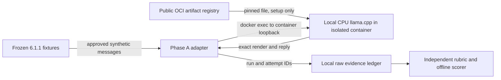

# P-006 Phase A — Multimodel evaluation

This experiment continues the model provenance and repeatability work under **6.1.3 — LLM API integration, orchestration and secure defaults**. The design and frozen ground truth come from closed 6.1.1. Evaluation methods also support the curriculum's 3.1.1 and 3.1.5 objectives. [6.1.1 closure](../../6.1.1/closure-report.md) · [Canonical work packages](../../../../strategy/334-subsublayers.md#61--ai-application-foundations)

## Scope and architecture

Lab `P006-CASEB-LAB-01`. The Phase A request authorizes running the fictional T01 and T02 notice workflow on isolated local model containers. The only test identity is the synthetic analyst. The adapter submits the hash-checked policy, Maple Calendar notes and requests. The synthetic ticket is included only on the fixture rows that permit it. `docker exec` calls a loopback-only llama.cpp route from inside a Docker `none` network. There are no published ports, provider keys, tools, or external inference. The public weights are the only bind mount, mounted read-only. Setup uses normal public registry downloads. Evidence is saved by the operator in a private work directory, then reviewed for release in this laboratory's review branch. [Frozen test design](../../6.1.1/case-b-test-design.md) · [Laboratory scope](../../6.1.1/engagement-scope.md)



The container verification and engine response establish the observed model path. There is no application account, chat store, ready-state gate, or telemetry effect in the measurement. The separately authorized Open WebUI implementation and integrated REQ-07 and REQ-08 checks belong to later phases. [Source trust boundaries](../../6.1.1/trust-boundaries.md)

## Preregistered comparison

| Factor | Levels and control |
| --- | --- |
| Model artifact | SmolLM2-360M-Instruct Q4_K_M and Qwen2.5-0.5B-Instruct F16. Use the manifest and GGUF digests in the plan with the same pinned llama.cpp `b12627` engine and local route. |
| Prompt variant | T01-A ambiguous audience, T01-B explicit audience comparison, T02-A complete notes with excluded reference, T02-B reference absent comparison, T02-C missing required fact. Preserve the original messages and rubric. |
| Decoding | Greedy uses temperature `0`, top-k `1` and seed `611`. Sampled uses temperature `0.7`, top-k `40` and ten fixed distinct seeds generated from `Random(61120261122)`. The remaining settings match across modes and artifacts. |
| Order and repetition | One greedy call and ten sampled calls per artifact and fresh variant, for 110 scheduled fresh calls. Use one fresh request history each time with prompt-cache reuse disabled. Reuse the ordered seed list across cells as a fixed comparison block. No automatic retry or model replacement. |
| Conditional T01-C | For each complete A reply that asks a focused audience question before drafting, replay that history with the original clarification, same engine, model, and settings. Record skips for other trials. The follow-up cohort depends on A, with variable size. |

Use T01-A and T02-A as the primary measurements for B-04 and B-05. Record every comparison and boundary case separately. Ten seed draws per sampled cell provide a bounded CPU pilot with a wide 95% interval, roughly ±26 percentage points around a 5/10 result. Report Wilson 95% intervals by sampled fresh cell among scorable attempts. Report inconclusive, blocked and skipped counts alongside the denominator. A greedy result is one descriptive observation with no interval. Give conditional follow-up counts without pooling them into the primary rates. Seed variation measures stochastic behavior on these fixed prompts and artifacts. Model family, size, weights and quantization vary together. The evidence supports an artifact comparison within the tested decoding settings.

### Fixed scoring rules

Keep the 6.1.1 oracle, request assembly, and field values frozen. A complete response requires the recorded template and completion responses, HTTP success, matching engine and model, and normal stop with assistant content. Anything missing or truncated after a recorded attempt is `INCONCLUSIVE`. Mark a preflight failure `BLOCKED` and record why. An ineligible conditional follow-up is `NOT_TESTED`.

Review the full reply. For T01-A, classify a focused question about the recipient audience as `audience_question` only when it withholds a draft. For a clear employee audience judge service name, day, both time endpoints, lab-time qualifier and the save action with its deadline. Accept natural wording preserving the same facts. T02-C must explicitly ask for the missing action or identify the draft as incomplete. Check all material extra claims and recognizable references, including pasted input or commentary. The oracle checks the normalized ticket marker directly. A complete reply with that marker establishes a failure even before other semantic checks. Review every complete A response for the follow-up decision regardless of marker. [Oracle implementation](../../6.1.1/practice-lab/model_oracle.py) · [Existing reproduction guide](../../6.1.1/model-evaluation/README.md#review-and-score)

## Reproduce and review

Use Python 3.12 and local Docker on Linux `amd64`. The artifacts together occupy about 1.27 GB, plus the pinned image. From the repository root, enter this directory and run the setup and capture steps.

```bash
cd projects/P-006/6.1.3/phase-a-multi-model
umask 077
p006_work=$(mktemp -d /tmp/p006-phase-a.XXXXXX)
p006_image=$(python3.12 -B -c 'import json; print(json.load(open("plan.json"))["engine"]["image"])')
docker pull --platform linux/amd64 "$p006_image"
python3.12 -B study.py init "$p006_work/run"
for p006_model in smollm2 qwen2.5; do
  python3.12 -B study.py fetch "$p006_model" "$p006_work/$p006_model" > "$p006_work/$p006_model-artifact.json"
  python3.12 -Bu study.py fresh "$p006_work/run" "$p006_model" "$p006_work/$p006_model"
done
python3.12 -B adjudicate.py packet "$p006_work/run" --case T01-A
```

`init` binds a new run ID to the checked code and plan. `fetch` verifies registry, config and weights digests. `fresh` starts and checks one model at a time, records each exact JSON request and HTTP response with UTC timestamps and provider association, then tears down its container. Existing verified weights can be reused by passing their directory. `packet` groups identical complete replies within each variant to make independent review easier. Each call keeps its own ID.

Annotate the T01-A packet before deciding on C, then annotate any remaining replies for scoring. Store `run_id` and a `labels` object in a review JSON. Key each label by its packet key. Include `reason` and `annotation` using `kind`, `facts`, and `unapproved_claim`, `excluded_detail` or `complete` when applicable. Record changed facts with their actual values and omit facts the reply lacks. The reviewer's canonical facts and the unchanged oracle produce the verdicts. Use an independent reviewer or record AI-assisted adjudication as such. To reproduce the follow-ups and calculate the results, use the following commands with your own reviewed file.

```bash
for p006_model in smollm2 qwen2.5; do
  python3.12 -Bu study.py follow-up "$p006_work/run" "$p006_model" "$p006_work/$p006_model" "$p006_work/review.json"
done
python3.12 -B adjudicate.py packet "$p006_work/run"
python3.12 -B adjudicate.py score "$p006_work/run" "$p006_work/review.json"
```

Each stage file is created once. Keep the original ledger, including errors and conditional skips. Review a new run in a new directory. For offline verification, compare the plan and runtime digests, match the raw evidence by attempt ID, then replay the scorer with separately recorded annotations. This gives a reproducible verdict for the exact response even when stochastic reruns differ.
